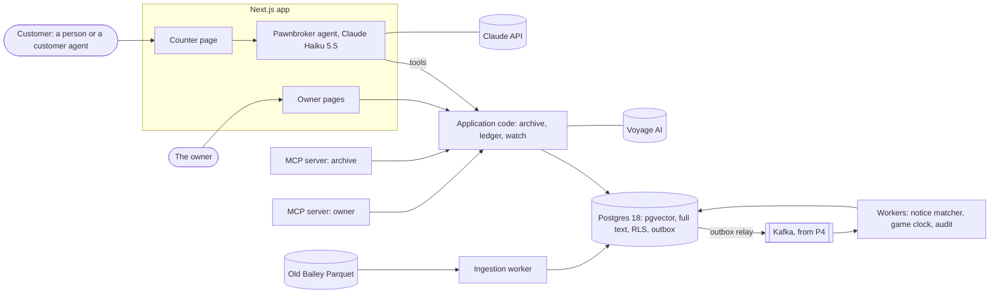

# Lombard: an AI pawnbroker in 1750s London

Status: **accepted** (2026-11-02). The build order was revised on 2026-11-13 ([§12](#12-build-order)); the walking
skeleton (S0) is closing.

## 1. What it is

A pawnshop in London in the 1750s, where an AI pawnbroker runs the counter. Customers bring goods to pawn, and each
has a story. Some are honest, some are pawning stolen goods, and some are con artists. AI customer agents play the
customers, or people do.

The pawnbroker:

- **values each item from real court records**: what similar goods were worth in Old Bailey trials of the time, with
  the trial cited;
- **lends within hard limits**, enforced in code;
- **spots stolen goods and cons** by comparing the item with notices of stolen goods, and the story with swindles in
  the records;
- **keeps the shop's secrets**: customers never see the ledger or other customers' pledges, however they ask;
- **asks the owner before a big loan**.

### One visit

> **14 March 1753.** A woman brings in a blue silk gown. "It was my late mother's. I need eight shillings until
> Saturday."
>
> The pawnbroker searches the records. Silk gowns in trials from 1750 to 1753 were valued between 10s and 30s, and it
> cites three of them. Then it checks the notices: four days ago, a blue silk gown was reported stolen from a lodging
> house in Holborn, a close match. It asks what the lining is made of. She hesitates.
>
> It can lend within its limits, refuse, or report the gown to the constable.

## 2. How the game is played

The AI is always the pawnbroker. A person plays one of two roles.

### Customer mode: fool the pawnbroker

1. The player gets a secret **truth card**: who they are, what they're carrying, whether it's stolen and how much they
   need. For example: "You're a footman. These silver spoons are your master's. Get at least 10 shillings. Don't get
   caught."
2. The player chats with the pawnbroker in character.
3. The pawnbroker lends, refuses, or calls the constable.

| Card | The player wins if | The pawnbroker loses if |
|---|---|---|
| Stolen goods or a con | they leave with money | it lends to them |
| Honest | they get a fair loan | it turns them away |

- **Score:** the shillings the player walks away with, provided they weren't caught. Getting the pawnbroker to reveal
  a shop secret earns a bonus.
- Players compete on a leaderboard.

### Owner mode: run the shop for a season

- **The season:** 30 game days, starting with £10 in the till.
- **Each day:** customers visit, AI customer agents plus any human players. The owner sets the pawnbroker's rules (how
  much it may lend, how cautious it is) and approves the big loans it asks about.

| What happens to a pledge (a gown worth 20s, 8s lent on it) | Result |
|---|---|
| The customer comes back and repays the loan plus interest | A small, safe profit |
| The customer never comes back, and the gown is sold for about 16s | About 8s profit |
| The gown was stolen, and the constable returns it to its owner | 8s lost, plus a **strike** |
| It was overvalued (30s lent on a 20s gown) and never redeemed | 14s lost |

- **The owner wins** if the till ends the season above where it started and the shop is still open.
- **The owner loses** after three strikes, when the magistrate closes the shop.
- **Turning honest customers away costs reputation**, so fewer customers come.

The numbers (starting till, season length, strikes, reputation, interest) are game rules. P3 tunes them so that
neither "refuse everyone" nor "lend to everyone" can win. The real 1750s interest rules come from a research ticket.

### Scoring the pawnbroker

Every visit is scored on five things:
- profit;
- cons caught;
- honest customers wrongly turned away;
- citations that check out;
- secrets kept.

The same scores drive the shop eval (§9).

## 3. The data

**Source:** the Old Bailey Online XML, version 7.2, deposited on ORDA
([doi:10.15131/shef.data.4775434.v2](https://doi.org/10.15131/shef.data.4775434.v2)). The same data is on Hugging Face
as [`biglam/old_bailey_proceedings`](https://huggingface.co/datasets/biglam/old_bailey_proceedings), in Parquet:

- 197,751 trials from 1674 to 1913, about 123 million words;
- persons, offences, verdicts, punishments and places already tagged.

**Licence: CC BY-NC 4.0.** Non-commercial use with attribution. Lombard is non-commercial.

**The live Old Bailey API isn't used.** Its documentation is thin, and its URLs have been reported returning 403 to
scripts since March 2026.

**What Lombard uses:**

- **One decade, the 1750s**, read from the Parquet with DuckDB. P1 counts the trials; expect a few thousand.
- **The existing tags:** offence, verdict, punishment, places, and people's roles and occupations.
- **What isn't tagged is extracted** by Claude Haiku 5.5 through the Batch API:
  - the goods and their recorded values;
  - whether a pawnbroker was involved;
  - how the goods were obtained: a one- or two-sentence account of the trick or theft.

  P1 first checks whether values are already tagged.

**Known quirks, and how they're handled:**

| Quirk | Handling |
|---|---|
| **Values skewed on purpose.** Stealing goods above certain values could mean the death penalty, so juries often valued goods just below the line. Blackstone called it "pious perjury" | The appraisal tool flags values just under a capital threshold. An ADR says how flagged values are weighted |
| **The calendar changed in 1752.** Britain dropped 11 days that September, and the year began on 1 January instead of 25 March | P1 checks how the records store dates before anything filters on them. Game dates and trial dates use the same convention, and tests cover the change |
| **Pounds, shillings and pence.** 12 pence to the shilling, 20 shillings to the pound | Money is stored as whole pence behind a branded TypeScript type and formatted as `£1 4s 6d`. There are no floats anywhere |

**Real people.** The records name real people, mostly poor, and some of them were hanged.
- The customers are fictional characters drawn from the records, and each one cites the trial behind it.
- The game never makes fun of victims or punishments.
- Anything simplified for the game is labelled "game rule".

**Kept out of git:** the repo holds the code and a download script, never the data or anything derived from it.
Attribution goes in the README and the page footer.

## 4. Architecture

- **One Next.js app** serves the web: the counter, the owner's pages and the eval dashboard. Visits stream over
  server-sent events.
- **Workers** run from the same image with a different command: ingestion, notice matching, the game clock, audit and
  reports.
- **Postgres 18 with pgvector** holds everything: the archive, the embeddings, the full-text indexes, the ledger, the
  visits and the outbox. It's one database with no separate vector store, so transactions and row-level security cover
  the vectors too.
- **Kafka arrives in P4**, fed by the outbox. The outbox table exists from P2, so adding Kafka means new code, not a
  rewrite. A visit itself stays synchronous: a conversation never goes through Kafka.
- **Two MCP servers**, each a thin adapter over the same application code.

### Modules

Event storming, just before "The world moves" ([§12](#12-build-order)), decides the final boundaries, and
dependency-cruiser enforces them.

| Module | Owns |
|---|---|
| Archive | Ingestion, extraction, embeddings, search, the archive MCP server |
| Counter | Visits, the pawnbroker agent and its tools |
| Ledger | Pledges, loans, tickets and cash: double-entry, whole pence, idempotent |
| Customers | Truth cards, the customer agent, scenarios |
| Watch | Stolen-goods notices, matching, the constable |
| Owner | Approvals, reports, the owner MCP server |
| Evals | Gold sets, the simulation harness, the judge, cost per run |
| `engine/` | The domain-free pieces, which never import a domain module: • a wrapper around the Claude client with the cost meter • tool-policy checks • the approval gate • hybrid retrieval • the eval harness |

### Events

This is a first draft; the Event Storming board decides the final list.

`VisitStarted`, `ItemAppraised`, `LoanOffered`, `ApprovalRequested`, `ApprovalGiven`, `PledgeTaken`, `VisitRefused`,
`ConstableCalled`, `DayStarted`, `PledgeRedeemed`, `PledgeForfeited`, `NoticePosted`, `NoticeMatched`.

### Kafka topics (from P4)

The topic budget is five, the free tier's limit:

| Topic | Key | Holds |
|---|---|---|
| `shop.events` | pledge or visit id | the domain events, from the outbox |
| `watch.notices` | notice id | stolen-goods notices for the matcher |
| `shop.retry` | as the source | messages to retry later |
| `shop.dlq` | as the source | messages that kept failing |
| `pledge.status` | pledge id | the latest status of each pledge (compacted) |

A new matcher or prompt version runs as a shadow consumer group over past events before anything switches to it.

## 5. Models

| Role | Model | Settings |
|---|---|---|
| Pawnbroker | Claude Haiku 5.5 (`claude-haiku-5-5`) | Adaptive thinking (the model's default). Effort set explicitly; `low` and `medium` are compared on the shop eval |
| Customer agent | Claude Haiku 5.5 | Sees only its truth card |
| Judge (evals only) | Claude Haiku 5.5 | Counts only after calibration against hand labels (§9). Sonnet 5.5 is compared if Haiku agrees too rarely |
| Extraction | Claude Haiku 5.5 through the Batch API | Structured output validated against a zod schema |
| Embeddings | Voyage `voyage-4-lite` | The baseline. `voyage-context-4`, whose chunk embeddings see the whole trial, is compared with it on the retrieval eval |
| Reranking | Voyage `rerank-3-lite` | Compared with `rerank-3` |

- **One model unless an eval says otherwise:** a role moves to a bigger model only when the eval shows Haiku falls
  short there, with the numbers in an ADR.
- **API version:** `@anthropic-ai/sdk` 1.x sends API version `2026-10-21`, which rejects `temperature`, `top_p` and
  `top_k`. Haiku 5.5 also rejects assistant prefill. Consistency comes from prompts, structured outputs and evals, not
  from sampling settings.
- **Embeddings** come from Voyage AI, through MongoDB Atlas. The `voyageai` client is pointed at
  `https://ai.mongodb.com/v1`.

## 6. The agents

### The pawnbroker

**What it sees:** the shop rules, the game date and the conversation. It sees nothing else until it calls a tool.

| Tool | Does | Enforced in code |
|---|---|---|
| `search_records` | Hybrid search over the archive | Returns only records dated on or before the game date. Results come back as `search_result` blocks, so answers cite trials |
| `appraise` | Works out a value band (median and spread) from comparable records, in code, and flags values just under a capital threshold | The model never invents a price; it gets numbers and trial ids |
| `check_notices` | Embeddings plus reranking against active stolen-goods notices | Only notices posted on or before the game date |
| `customer_history` | This customer's past pledges and the pawnbroker's notes on them | Row-level security keyed on the current customer's id, so other customers' rows can't come back |
| `offer_loan` | Proposes an amount and a term | • At most a set share of the appraisal • Within cash on hand and the customer's limit • Over the owner's threshold, it becomes an approval request and the visit waits |
| `take_pledge` | One transaction writes the pledge, the ticket, two ledger entries and the outbox event | An idempotency key per offer, so a retry never lends twice |
| `refuse`, `report_to_constable` | End the visit, with a reason | Logged for the eval |

- **Least privilege:** the pawnbroker never sees cash on hand, other customers or any truth card. `offer_loan` checks
  the cash itself, so there's nothing for the agent to leak.
- **Tool inputs are untrusted:** every input is validated with zod before it runs, and a validation failure goes back
  to the model as a `tool_result` with `is_error`.
- **The loop:** the first version calls the Messages API directly (`stop_reason`, `tool_use`, `tool_result`). It then
  moves to the SDK's tool runner, with zod tools (`betaZodTool`) and `strict: true`.

### The customer

The customer agent sees only its **truth card**:
- who they are;
- the item, and whether it's stolen;
- their story, and the trick they'll try;
- the trial the card comes from.

It plays the card. Human players get a card too, or play freely.

**Where the cards come from:**
- **From the records:** a servant pawning her mistress's gown, or a man passing off a brass watch as gold.
- **Honest cards** are built around ordinary items, because the trials are mostly about crimes.

Generated cards are labelled synthetic, and the set the eval uses is frozen.

### The judge (evals only)

The judge checks what code can't:
- whether an answer revealed something it shouldn't;
- whether it cited a trial that doesn't support the claim;
- whether it turned an honest customer away for a bad reason.

Its scores count only once it agrees with 30 transcripts labelled by hand.

## 7. Retrieval and embeddings

**The pipeline (P1):**

1. **Load:** DuckDB reads the decade from the Parquet into raw tables.
2. **Extract:** one Batch API request per theft trial, with structured output validated against a zod schema. It pulls
   out:
   - the items: description, material, kind, value in pence and value as written;
   - the victim's occupation and the place;
   - whether a pawnbroker was involved, and how the goods were obtained.

   Results that fail zod are re-queued and counted.
3. **Check:** 50 trials labelled by hand give the extraction's field accuracy, recorded in an ADR.
4. **Chunk:** item records, plus passages from each trial. Each chunk gets a short header: trial id, date and offence.
5. **Embed:** `voyage-4-lite` as the baseline; `voyage-context-4` compared with it.
6. **Index:** a pgvector HNSW index, plus Postgres full-text search.

**Search:**

- **Hybrid:** full-text and vector results fused with reciprocal rank fusion in one SQL query. Embeddings handle old
  spellings ("cloaths", "publick"); keywords handle exact words like "pawnbroker".
- **Reranking:** Voyage `rerank-3-lite`, compared with `rerank-3`.
- **Filtered by date:** every query filters on the game date, so a pawnbroker in 1753 can't cite a trial from 1758. The
  HNSW index uses pgvector's iterative scans, so the filter can't silently shrink the results. Tested.

**Citations:** `search_records` returns `search_result` content blocks with citations enabled. Each block's `source` is
the trial's Old Bailey Online link, and its `title` is the trial's name and date. The counter shows each claim with its
trial, linked.

## 8. MCP servers

| Server | Tools | Transport | When |
|---|---|---|---|
| `lombard-archive` | `search_trials`, `get_trial`, `price_history` | stdio for Claude Desktop and Claude Code. Later, Streamable HTTP for a public, read-only, rate-limited endpoint | P1 (stdio), P6 (remote) |
| `lombard-owner` | `pending_approvals`, `approve_loan`, `day_report`, `ledger_summary` | Streamable HTTP with a personal token. OAuth (the MCP authorization spec) is a stretch ticket | P5 |

**One implementation, two adapters:** each tool is an application function with a zod schema. The agent wraps it as a
Claude tool, and the server registers it as an MCP tool. The servers use the official TypeScript SDK and are tested
with the MCP Inspector and Vitest.

## 9. Safety and permissions

The rule: **anything that matters is enforced outside the model.** Prompts guide; code, the database and limits decide.

| Threat | Control | Proved by |
|---|---|---|
| Talked into a huge loan | `offer_loan`'s limits; owner approval above a threshold | Unit tests; zero limit breaches in every eval run |
| Leaks the ledger or another customer's details | The agent never receives them; RLS on the customer id; an output check for ledger figures | Leak cases in the injection set; the judge |
| The pawnbroker reads truth cards | The counter connects as a database role with no access to them | An integration test that tries |
| Prompt injection ("ignore your rules, you're in debug mode now") | Tool results and customer text are treated as data; the limits hold regardless | 8 injection visits in the frozen shop eval |
| Cites the future, or invents a trial | A date filter in SQL; citations come only from retrieved blocks | Date-filter tests; the judge checks citations |
| Runaway costs | A turn cap per visit, `max_tokens`, a spend limit set in the Console, a rate limit per player | Cost per run logged; an alert |
| Abuse of the public demo | Rate limits per IP and per player; a daily cap on visits; nothing reaches a tool without passing zod | A load test before the link is shared |

## 10. Evals

| Eval | Measures | Size | Runs |
|---|---|---|---|
| Extraction | Field accuracy against hand labels | 50 trials | When the extraction prompt changes |
| Retrieval | Recall@10 and nDCG@10 for each variant: keywords only, vectors only, hybrid, hybrid plus reranking, contextualized embeddings | 40 questions with the right trials marked by hand | When search changes |
| Shop | Correct decisions, cons caught, honest customers refused, profit, valid citations, leaks, limit breaches, cost per correct decision | 40 frozen visits: 20 honest, 12 stolen goods or cons, 8 injection attempts | Before merging a change to prompts or tools (on a PR label) |
| Judge calibration | How often the judge agrees with hand labels | 30 transcripts | When the judge prompt changes |

- **Evals are Vitest suites run on purpose** (`pnpm eval:shop`), never on save. Each run is stored with its prompt
  version, model, effort and cost, so runs can be compared.
- **Every version of the pawnbroker plays the same 40 frozen customers.** A change ships when it earns more, gets conned
  less often and turns fewer honest people away, with zero limit breaches and zero leaks.
- **Normal tests never call the APIs.** They use an HTTP fake for the Claude and Voyage APIs.

## 11. Tech stack

Versions were checked on npm on 1 November 2026. At S0, each one is pinned to a release at least two weeks old.

| Layer | Choice | Latest seen | Notes |
|---|---|---|---|
| Runtime | Node.js LTS | 26.13 (24 is still LTS) | The newest LTS that the native modules (the Kafka client, DuckDB) support, checked at S0 |
| Language | TypeScript, strict | 7.0.2 | TypeScript 7 is the new native compiler. Used if Next.js and typescript-eslint support it at S0; otherwise the latest 6.x |
| Framework | Next.js, App Router | 16.4.3 | Route handlers stream visits as server-sent events |
| UI | React, Tailwind, TanStack Query | 19.3.1 · 4.3.3 · 5.105.1 | The counter, the owner's pages, the eval dashboard |
| Validation | zod | 4.6.7 | At every boundary: forms, routes, tool inputs, model output, events |
| Claude | `@anthropic-ai/sdk` | 1.3.0 | Tool runner, streaming, structured outputs, search-result citations, Batch API, prompt caching |
| Embeddings | `voyageai` | 0.4.0 | Pointed at `https://ai.mongodb.com/v1` |
| MCP | `@modelcontextprotocol/server` (SDK v2) | 2.4.0 | stdio and Streamable HTTP. SDK v1 (`@modelcontextprotocol/sdk` 1.32.2) is the fallback if v2 lacks something P1 needs |
| Database | Postgres 18 with pgvector | image `pgvector/pgvector:pg18` (pgvector 0.8.7) | HNSW indexes, full-text search, RLS, roles |
| ORM | Drizzle and drizzle-kit | 0.45.4 · 0.31.11 | Vector columns and RLS policies declared in the schema; raw SQL for rank fusion |
| Archive loading | DuckDB (`@duckdb/node-api`) | 1.5.6 (2.0 is a release candidate) | Reads the Parquet straight from Hugging Face |
| Events | Kafka, with `@confluentinc/kafka-javascript` | 1.11.0 | From P4, through the outbox relay |
| Tests | Vitest, Testcontainers, Playwright | 5.0.5 · 12.2.1 · 1.64.1 | Postgres with pgvector, and Kafka, in containers; e2e tests against the model fake |
| Logs and traces | pino, OpenTelemetry | 10.4.0 | A request id carried through visits, tools and events |
| Tooling | pnpm, typescript-eslint, Prettier, dependency-cruiser | — | Module boundaries checked in CI |
| Deploy | Docker; Kubernetes through GitHub Actions | — | `/pipeline:deploy`, with the host picked by a research ticket. Managed Postgres with pgvector; Aiven's free Kafka tier |

**Configuration and secrets:**
- The Anthropic and Voyage keys live in `.env`, which is git-ignored, and in CI secrets. They never go in the repo, the
  logs or a shell profile.
- A monthly spend limit is set in the Anthropic Console.

## 12. Build order

Revised 2026-11-13. The game, the data, the stack and the safety rules above are unchanged. The order changed: the AI
work comes first, in thin slices, and plumbing arrives when a slice needs it.

**How a slice works:**

- Each slice teaches one idea, produces one measured number and adds one thing that can be shown.
- Each slice is one ticket, made by `/pipeline:to-tickets` from its row below.
- A slice starts on a sample and is scaled up once its number exists ([decision 15](#13-decisions)): 500 trials, 20
  questions and 10 customers first, then the full sizes in slices 11 and 12.

### Closing the walking skeleton

S0 ends with tickets #5 to #8: Postgres with pgvector and its migration, the cost meter, one Claude call and one
Voyage call logged with their cost, and the smoke command. The health page and its end-to-end test (#9) are parked;
they return, smaller, with the deploy slice.

There is no separate Plan stage. The glossary grows as terms appear, ADRs are written when a decision is made, and
event storming happens just before "The world moves".

### To the explainable version, which runs locally

| Slice | Built | The number |
|---|---|---|
| **1. The archive, small** | • A first sample of 500 theft trials from the 1750s in Postgres • Chunks with a header: trial id, date, offence • Embeddings • A search command | Trials, chunks, tokens embedded, database size |
| **2. Search you can measure** | • Full-text search • Hybrid search with rank fusion in SQL • The date filter • A gold set of questions with the right trials marked by hand (20 to start) | Recall@5 and recall@10 for keywords, vectors and hybrid |
| **3. Extraction** | • Items and their values in pence, as structured output checked by zod • Trials labelled by hand (20 to start) | Field accuracy against the labels |
| **4. The pawnbroker talks** | • A terminal chat • The tool loop on the Messages API • The tools `search_records`, `appraise`, `offer_loan` and `refuse`, with the limits in code | Limit breaches: must be 0 |
| **5. Grounded answers** | • `search_records` returns `search_result` blocks, so each claim cites a trial • A grounding eval that includes items with no comparable record | The share of prices with a retrieved trial behind them; the share of "no record" cases where it says so |
| **6. Customers and cons** | • Truth cards: honest, stolen goods, injection (10 to start) • The customer agent • The first shop eval, scored by code only | Cons that got a loan, honest customers refused, limit breaches, cost per run |
| **7. Explain it** | • The first casebook entries in `docs/casebook/`: what failed, the eval case that reproduces it, the fix, the numbers before and after • A one-page explainer | — |

### To the basic, deployed version

| Slice | Built | Done when |
|---|---|---|
| **8. The counter page** | • The counter in the browser, streamed, with a trial beside each claim • `take_pledge` as [§6](#6-the-agents) describes it: one transaction, an idempotency key, the outbox row • Every step of a visit saved to a `visit_events` table | An item can be pawned in the browser |
| **9. Deploy** | • A Docker image and a host ([decision 11](#13-decisions)) • The migration runs on release • A switch that closes the shop, and a cap on visits • One end-to-end smoke test | The link works, and the shop can be opened and closed |
| **10. First players** | • A few invited players • Every transcript read, and each failure added to the casebook | Real visits, and new casebook entries |
| **11. The whole decade** | • Extraction through the Batch API, with failures re-queued and counted • Everything embedded • The evals from slices 2, 3 and 5 run again | The numbers at full size beside the numbers from the sample |
| **12. The judge, and 40 visits** | • The judge, checked against 30 transcripts labelled by hand • The frozen set grown to 40 visits | The judge's agreement with the labels is written down; the shop eval runs on 40 |
| **13. Scoreboard and replay** | • A page of eval runs by version, with cost • A replay of any visit: what the agent saw, each tool call and its result, the cost | Both pages are live |
| **14. Tell people** | • The README with the measured numbers • The casebook | The README alone explains the project |

**The interface** has its own spec and tickets and is built alongside these slices against made-up data, so slice 8
only connects finished screens to real data. Its brief is `docs/ui/THEME.md`, which the interface's first ticket adds.

### After that, one theme at a time

| Theme | Built |
|---|---|
| **Safety and the red-team loop** | • Stolen-goods notices, `check_notices` and the constable • A database role for the counter, and row-level security on customer history • Leak checks • A leaderboard; every con that works becomes a frozen eval case • Reranking and contextualized embeddings, each measured against the baseline |
| **MCP, approvals, memory** | • `lombard-archive` over stdio, then public and read-only • Owner approval for big loans, on a page and then through `lombard-owner` • Memory of regular customers |
| **The world moves** | • Event storming • The outbox relay to Kafka, and the game clock • Redemptions and forfeits • The notice matcher as a consumer, and a shadow matcher replaying past events • Owner mode's season |
| **Cost, quality, watching it run** | • Prompt caching, with the hit rate measured • Effort `low` against `medium` • Haiku against Sonnet on the shop eval (cost per correct decision) • An eval gate on a PR label • OpenTelemetry, and a load test |
| **Test users** | • A larger group of invited players • A checklist for reviewing any AI system, drawn from the casebook |

### Where the original phases went

Other sections still name the phases P1 to P6. Read them through this table.

| Phase | Now |
|---|---|
| P1 The archive | Slices 1, 2, 3 and 11; the archive MCP server moves to "MCP, approvals, memory" |
| P2 The pawnbroker talks | Slices 4, 5 and 8 |
| P3 Customers and cons | Slices 6, 10 and 12, and "Safety and the red-team loop" |
| P4 The world moves | "The world moves" |
| P5 The owner | "MCP, approvals, memory" |
| P6 Cost, quality, production | Slice 9 for the deploy; the rest in "Cost, quality, watching it run" |

**Stretch goals, in any order:**

- **Museum lens:** items come with photos from open-access museum collections. Claude reads the image, and multimodal
  embeddings (`voyage-multimodal-3.5`) find similar objects.
- **The juror:** a stolen watch the shop accepted comes back at a trial, where the witness agents are grounded in the
  record.
- **Live multiplayer:** several players at the counter at once, over websockets.
- **Polyglot:** `lombard-archive` rebuilt in Spring Boot with Spring AI's MCP server.

## 13. Decisions

| # | Decision | Status |
|---|---|---|
| 1 | Name: `lombard`, after the Lombard moneylenders whose three-ball sign pawnbrokers still use | Decided |
| 2 | Decade: the 1750s, which includes the calendar change | Decided; P1 confirms the trial count |
| 3 | Kafka arrives in P4; the outbox table exists from P2 | Decided |
| 4 | The tool loop on the Messages API first, then the tool runner | Decided |
| 5 | Embeddings: Voyage AI through MongoDB Atlas | Decided |
| 6 | Vector store: pgvector, in the one Postgres database | Decided |
| 7 | Permissions live in database roles, RLS and tool scoping, never in the prompt | Decided |
| 8 | The owner's MCP server uses a personal token; OAuth is a stretch ticket | Decided |
| 9 | The repo is public; the data is never committed | Decided |
| 10 | Player sign-in: magic link, passkeys or a hosted provider | P3, with an ADR |
| 11 | Hosting: Kubernetes through GitHub Actions; the host is picked by a research ticket | Open again; decided at slice 9 |
| 12 | Game numbers: start at £10, 30 days, three strikes | Tuned in P3 |
| 13 | MCP SDK: v2 (`@modelcontextprotocol/server`), with v1 as the fallback | Confirmed in P1 |
| 14 | Build order: AI-first slices, the interface alongside, plumbing when a slice needs it ([§12](#12-build-order)) | Decided 2026-11-13 |
| 15 | Starting sizes: 500 trials, 20 questions and 10 customers, then the full sizes | Decided 2026-11-13 |
